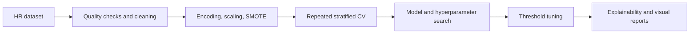

# Employee Turnover Prediction

> A reproducible HR-analytics experiment focused on identifying employees at risk of attrition while controlling the precision-recall trade-off.


## Why this project

Employee attrition is usually an imbalanced classification problem: the costly cases are the relatively small number of employees who leave. This pipeline therefore optimises for recall under a minimum precision constraint instead of selecting a model from Accuracy alone.



## Methodology

- removes duplicates, constants, identifier-like columns, and highly incomplete features;
- supports clipping or removing numerical outliers with the IQR rule;
- preprocesses numerical and categorical variables in a leakage-safe pipeline;
- compares Logistic Regression, Decision Tree, Random Forest, Gradient Boosting, KNN, SVM, and MLP;
- uses SMOTE inside the cross-validation pipeline;
- performs repeated stratified cross-validation and grid search;
- selects a decision threshold that maximises Recall while targeting Precision >= 0.40;
- explains behaviour with Logistic Regression coefficients, SHAP, ROC curves, confusion matrices, and t-SNE projections.

## Run locally

```bash
python -m venv .venv
# Windows: .venv\Scripts\activate
# macOS/Linux: source .venv/bin/activate
pip install numpy pandas matplotlib scikit-learn imbalanced-learn shap
python test1_with_metrics.py
```

The script expects `dataset.csv` in the repository root and a binary `Attrition` column containing `Yes` and `No`.

## Generated artifacts

- `results_with_data_prep_repeatedcv_auc_fullplots.csv`
- class-distribution and correlation plots
- model-coefficient chart
- SVM ROC curve and tuned-threshold confusion matrix
- true-label and predicted-risk t-SNE plots
- SHAP summaries for selected models

## Responsible use

This repository is a research and education prototype, not an automated HR decision system. Attrition scores should never be used to penalise employees; real deployment would require fairness analysis, privacy controls, human review, and monitoring for distribution shift.
